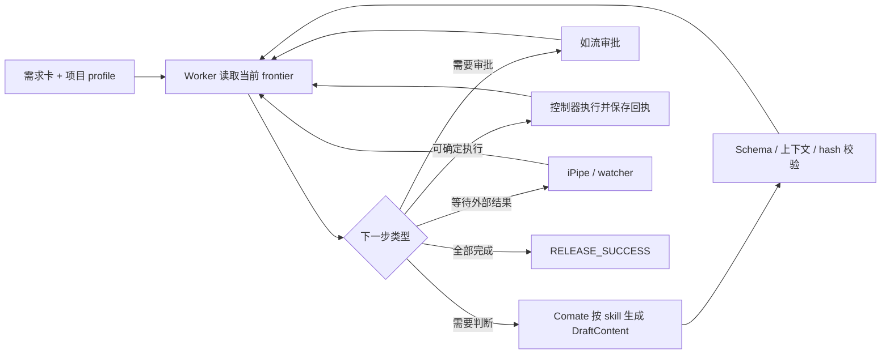

# Tom Autodev

**用一句命令启动需求，用模型完成判断，用控制器校验和推进，用人工审批关键动作。**

Tom Autodev 把一张 iCafe 需求卡推进到代码、独立产品测试、Review、iCode、iPipe 和发布确认。每个需求都有一个持久化 `run`，输入、产物、审批、锁、外部回执和恢复信息都会保存下来。

适用环境：**任一 code agent（Comate / Claude Code / Codex）+ iCafe / iCode / iPipe / KU / 如流**。agent 相关的路径和会话识别集中在 `tom-autodev/scripts/agent_host.py`。Mac 负责源码、流程控制和 Review；编译、模拟器和业务测试在配置好的 iPipe runner 执行。

下游下载产物按本 run 冻结 Change Set / pipeline_plan 判断模块是否 changed，不能用
worktree clean 推断。未变模块取目标 branch 的 BranchPipeline 成功发布产物，验证实际源码
revision 与下载；缺产物时仅允许有平台契约证明的 compile-only 动作，禁止触发 release。
有变模块取本 run 所有的 ChangePipeline、当前 branch、exact candidate revision 的成功
compile 产物。历史 compile、latest 或固定 URL 均不能代替。人工阶段即使 manualParams 为空，
也检查 job 声明及上游输入；准确 override 能力不明则 blocking，不修改外部流水线模板。
当前 HTTP 适配器尚无 compile-only/job override 契约证据，两项显式阻断，fake 测试覆盖
授权 binding、持久化 intent 和未知结果只查回。详见
[阶段协议](tom-autodev/references/phase-protocol.md)。

## 先看这一页

### 你只需要记住 4 个动作

```bash
# 1. 创建或继续一张需求卡，并推进到下一个待办
python3 tom-autodev/scripts/cli.py process CARD PROJECT

# 2. 查看进度
python3 tom-autodev/scripts/cli.py status CARD_OR_RUN

# 3. 查看模型当前要填什么
python3 tom-autodev/scripts/cli.py context CARD_OR_RUN

# 4. 审批后继续
python3 tom-autodev/scripts/cli.py continue CARD_OR_RUN
```

模型需要提交草案时，再执行：

```bash
python3 tom-autodev/scripts/cli.py submit-draft CARD_OR_RUN JOB_ID draft.json
```

`submit-draft` 只接收当前 schema 要求的 `DraftContent`，不接收 `ArtifactEnvelope`。需要审批时，CLI 会自动发起绑定当前草案和 `approval_input_hash` 的审批；成功返回 `PARKED / APPROVAL_WAIT`，不会自动批准。

IMPLEMENT 的 Change Set 不手工拼 patch 或哈希，而是由控制面从任务自有、已提交的干净 HEAD 只读提取：

```bash
python3 tom-autodev/scripts/cli.py prepare-change-set CARD_OR_RUN JOB_ID metadata.json --output change-set.json
```

`metadata.json` 只含 `change_set_id`、`task_id`、`test_ids`、`traceability_delta`、`deviations`。`--output` 只独占创建新文件，已存在则拒绝覆盖。schema 要求 `business_patch` / `test_patch` 是完整 Git patch，空字符串只允许配合 `patch_kinds` 的 `no-op`；SHA、路径、摘要或占位文本会被拒绝。

PLAN 阶段发现计划与已批准 Spec 冲突时，用 `report-producer-conflict CARD_OR_RUN JOB_ID report.json` 上报（schema 见 `producer-conflict.schema.json`，报告的 `job_id` 必须与当前 job 一致）；控制器以 `SPEC_CONFLICT` 转入 DIAGNOSE，不会伪造任务计划。

PLAN 的 `repositories[].path` 必须填 profile 的本地检出路径（绝对路径），不能写模块名（如 `baidu/sysip/x86bgw`）。G4 会校验该路径为非空绝对路径，否则以 `PLAN_REPOSITORY_MISMATCH` 拒绝；IMPLEMENT 的 `prepare_change_set` 仍按 profile 路径定位 worktree 做权威绑定。

在任一 agent（Comate / Claude Code / Codex）中可以直接使用卡片动作，不必手写 Python CLI：

```text
/tom-autodev BGW-1995 开始
/tom-autodev BGW-1995 结束
/tom-autodev BGW-1995 状态
/tom-autodev BGW-1995 当成状态
/tom-autodev BGW-1995 继续
/tom-autodev BGW-1995 重新开始
```

这些动作的映射不是简单的同名替换：

- `开始` → `cli.py process CARD PROJECT`，会创建/定位 run 并驱动；裸
  `cli.py start` 只创建 run。
- `结束` → `cli.py stop CARD_OR_RUN`，停止活动 run但保留审计记录。
- `状态` / `当成状态` → `cli.py status CARD_OR_RUN`。
- `继续` → `cli.py continue CARD_OR_RUN`；只读检查点才使用 `resume`。
- `重新开始` → 停止选定的活动 run，再执行 `start --fresh` 和 `drive`。

卡片只对应一个活动 run 或一个已确认项目时，可以省略 `PROJECT`；多个候选时
必须先选择，不能根据 `BGW-` 前缀、目录名或最近使用记录静默绑定项目。完整映射见
[`chat-commands.md`](tom-autodev/references/chat-commands.md)。

协作群名称按当前 iCafe 快照的卡片标题即时派生，项目 profile 中的
`approval_channels.group_topic` 仅为旧配置兼容字段，不再覆盖新需求主题。若历史 run
检测到群名/主题与快照不一致，`drive`、`continue` 和 `process` 会在任何外部写入前停止并提示
保留审计记录后执行 `stop` + `start --fresh`，不会复用旧群 intent。
建群回执只把有效 `group_id` 作为成功必要条件；平台不回显 `bot_id` 不再被误判为建群失败。
网关会按 run intent 持久化脱敏回执，`continue` 在恢复门禁前先查询并补写同一 intent，
不会重复 create。旧版本没有回执 journal 时仍会停在 `QUERY_REQUIRED`，必须提供明确 group ID
完成核对后再认领，不能按群名猜测。
已知准确群 ID 且需要处理旧版本 pending intent 时，使用
`python3 tom-autodev/scripts/cli.py adopt-group RUN_ID GROUP_ID --actor USER`；它只做按 ID
的信息/成员核对并补写原 intent，不重新创建群。

KU 适配使用已安装的 `/ku-doc-manage` skill，而不是依赖 PATH 中恰好存在 `ku` 命令。
入口可通过 `TOM_AUTODEV_KU_BINARY`、`TOM_AUTODEV_KU_SKILL_DIR` 或 `COMATE_SKILL_DIR`
覆盖；操作身份通过 `BAIDU_CC_USERNAME` 传递。skill 输出的 debug 前缀和 JSON 响应会被
正确分离，避免正常 KU 查询被报告为 `KU_QUERY_UNKNOWN`。

### 审批消息与进度通知

- 审批详情会说明本次对象、逐项核对重点、应读文件/证据、固定版本，以及同意后允许执行的动作。G0–G10 和 `PROFILE_REPIN` 都有各自的检查重点。
- 自动草案审批会提供本次材料的本地 JSON 快照路径；这是阅读副本，不是已验收产物。路径只能在运行机器打开，已有 KU 文档才显示网页链接。缺少与 hash 匹配的材料会明确提示“请勿批准”。
- 如流正文旁有“同意 / 需修改 / 停止run”按钮（“停止run”即原“驳回”，停止本 run）。有协作群时发群；G0 尚未建群时发给审批成员的机器人单聊。
  后续审批正文和操作示例统一使用中文：“同意 <approval_id>”会继续当前 run；
  “需修改 <approval_id> <修改意见>”会保留 run、按意见重做并重新发起本门；
  “停止 <approval_id>”会停止 run。按钮未完整送达会单独提示。“需修改”适用于
  G1–G6；G5 的修改意见会原地重做 IMPLEMENT，G6 的会原地重做诊断。
- 在如流提意见有三种方式，均有可视化回执：
  1）点“需修改”后直接在本群回复意见（不用带审批 ID，可分多条，到你对本审批再次回复或对别的审批选“需修改”为止）；网关收到后立即把该卡刷新为“已收到修改意见…”，watcher 再登记重做并回执；
  2）一次回复“需修改 <审批ID> <意见>”；
  3）在驱动本 run 的 agent 会话里直接用 `/tom-autodev <卡片> 需修改 <意见>`：对当前待审批/已选需修改的门直接提意见并原地重做，无需先点如流按钮。
- GRILL 之后的需求变更不会被吸收进 Spec/计划/代码：PLAN/IMPLEMENT 以
  `USER_REQUIREMENT_CHANGED` 上报，诊断只能路由 `GRILL`，G6 批准后回到决策日志重新取得
  G1 及之后各门；重做阶段的审批卡会列出已批准诊断的修复方向与修复计划。
  历史英文回复仍兼容，但新审批不再展示英文命令，也不能把“驳回”当作修改入口。
- 审批卡网关可用 `GET /health` 检查，响应包含 `version`；卡片重发会使用新的
  `approval_id`、保留相同 `input_hash`，并重新投递完整的三个审批按钮。超时重发仍受
  审批台账、幂等和 retry 次数约束，不应直接调用底层卡片接口绕过控制器。
- “进度通知（非审批）”只报告停驻位置，不请求批准，也不代表阶段完成。没有待审批账本记录时，不会让你处理一个尚未创建的审批。
- 点击只表示收到选择。最终是否有效以权限、有效期、hash 和送达回执校验后的审批回执为准；审批本身不会推进业务阶段。
- 当 run 因 `WORKFLOW_SPEC_DRIFT` 停驻时，`WORKFLOW_SPEC_MIGRATION` 是唯一允许在
  drift 状态下消费的审批类型。迁移门会先按原 run、approval、input hash、审批成员、
  群组和送达回执校验回复，再应用精确的旧/新 workflow hash；普通 G0–G10 审批仍会
  被 drift 守卫阻断。迁移审批的重复消费必须复用原 approval 和 intent，不能手改账本或
  创建第二张迁移卡。
- `IMPLEMENT → DIAGNOSE` 的 producer-block 前驱证据可以位于 transition payload 的
  `evidence` 对象中。控制器会同时校验 run、task、business/tests revisions、报告内容
  和 artifact hash；缺失或不一致时 fail-closed。若修复前已创建合法的 DIAGNOSE
  ProducerJob，控制器只允许按同一 run、事件、任务、producer-block 父证据，对仍为
  pending 或已 FULFILLED 且带诊断草案的 job 做受限兼容恢复，不能按 action 前缀或最近
  记录猜测 job。兼容恢复只处理 `ACTION_CONFLICT`；`WORKFLOW_SPEC_DRIFT` 必须先走
  `WORKFLOW_SPEC_MIGRATION`，不会在漂移状态下认领 job 或写模型回执。兼容恢复提交时只会
  使用当前已核验 producer-block artifact 的精确 `artifact:<id>` evidence reference；
  不会从历史空 refs、外部输入或伪造路径补证据。
- G5 只对应真实 IMPLEMENT Change Set 的审批。若 IMPLEMENT ProducerJob 因计划与
  已确认方案不一致而进入 `DIAGNOSE`，此时没有代码改动，也不会创建 G5；应先完成
  G6 诊断，再按修复路由重新生成 PLAN/G4，待真实 Change Set 产生后才申请 G5。
- 审批展示层使用中文：枚举、固定提示、按钮和回复示例都有中文文案，诊断 skill 要求
  `hypothesis`、`repair_plan` 等展示字段直接用中文书写。没有精确译文的英文长文本
  原样展示并标注「（未翻译原文）」，不做词级替换，避免丢失否定词等导致审批人读到
  与哈希绑定草案相反的含义。若已投递的待审批卡片展示异常，可使用同一 `approval_id`、
  `input_hash` 和截止时间的受控消息纠正（`correct-approval-message`），不创建第二张
  普通审批，也不改变审批绑定；网关发送前拒绝时撤回投递意图，结果不明时保留意图待核对。
- 重复「同意请回复 …」的消息（截止前提醒、消息纠正）会在其下方补一张同一审批的按钮卡；
  任一张卡被审批人点击后，网关会关闭同一审批的其它卡。同一张卡的连续点击串行刷新，
  已处理的卡不会因重复点击重新出现按钮。提醒优先重放最近一次已送达的纠正正文。
- 进度路线只把沿正常路线离开的阶段标为 ✓；进入 DIAGNOSE 或恢复分支的前驱阶段标为 ✗
  （例如 IMPLEMENT 被 producer-block 阻断），回退到较早阶段时其后阶段全部重置为 ○。
- 如流已回复并落账精确的 `WORKFLOW_SPEC_MIGRATION` 批准时，`continue` 会按当前 run 与
  当前迁移计划的 `input_hash` 消费该批准并应用迁移，再交给 worker 恢复；它不会自动批准或
  重开审批。`status` 只读显示「迁移已批准待应用」。
- 显式命令（`migrate-workflow-spec`、`ipipe-rebuild`、`ipipe-rerun`、`submit`、`advance`、`rewind`、
  `repin-profile`、`optimize apply`）成功消费审批后，会完成该审批对应的 `APPROVAL_RESUME` handoff；
  `continue` 遇到多条 handoff 时，只清理指向旧事件且审批已被消费/门禁已不符的过期项（审计原因 `STALE_EVENT`），
  匹配最新事件的有效 handoff 与 REJECT 审批的 handoff 不受影响。

具体规则与门禁材料清单见 [Approval Policy](tom-autodev/references/approval-policy.md)，G0/G5/G9 与非审批通知的对照见 [消息示例](docs/APPROVAL_UX_EXAMPLES.md)。

### 一张卡的完整路径

```text
确认需求和项目
  → Intake / Grill
  → Spec + 任务 DAG
  → 工作区
  → 计划
  → 业务代码 + 独立产品测试
  → Review
  → iCode 提交
  → iPipe 编译、测试、回归
  → 发布确认
```

有代码或测试问题时进入 `Diagnose`，再回到 Spec、Plan 或 Implement。iPipe 失败必须按真实平台证据处理；控制器不会把本地结果当成 iPipe 结果。

## 原理：谁做什么

| 角色 | 负责什么 | 不能做什么 |
|---|---|---|
| 人 | 确认需求和验收标准；审批设计、改动、提交、重跑和发布 | 不能用聊天内容替代绑定具体版本的审批 |
| Comate + skill | 澄清、设计、拆任务、生成代码和测试、Review、诊断 | 不能直接改状态、伪造 envelope、提交 iCode 或触发 iPipe |
| Python 控制器 + WorkerDriver | 计算下一步、校验 schema/hash/版本/前驱、保存状态、执行已批准动作 | 不猜测缺失输入，不重复外部副作用 |
| iPipe | 在固定版本和环境中编译、测试、回归并返回证据 | 不接受本地模拟结果冒充平台证据 |

模型只返回内容。WorkerDriver 负责把内容封装成产物、绑定审批、校验并推进状态。需要模型时返回 `ProducerJob`；需要人工时返回 `ApprovalJob`；需要外部结果时保存检查点并等待。



## 工作流怎么走

### 默认路径和变体

| 路径 | 用途 | 已减少的步骤 |
|---|---|---|
| `standard` | 普通需求 | Spec 和任务 DAG 合并为一次 ProducerJob |
| `express` | 已有明确验收点的缺陷或小改动 | Grill 可自动生成，部分设计审批合并 |
| `hotfix` | 紧急修复 | 计划仍生成，但独立 G4 审批可省略 |
| `full` | 大型、跨仓或高风险需求 | 保留完整 Spec、Tasks 和审批路径 |

路径由运行开始时固定，并写入 run。复杂需求可显式选择 `full`；不能在中途静默降低风险等级。

项目和语言知识按需加载：BGW 使用 `tom-lang-c-cpp` + `tom-project-bgw`，XFlow 使用 `tom-lang-npl` + `tom-project-xflow`。流程职责由 `tom-autodev`、`tom-grill`、`tom-spec`、`tom-tasks`、`tom-plan`、`tom-implement`、`tom-review` 和 `tom-diagnose` 分担；standard 路径会合并可合并的模型工作，不要求每个 skill 都单独启动一次 agent。

### 阶段职责

| 阶段 | 产物或动作 | 关键控制 |
|---|---|---|
| Intake / Grill | 需求快照、协作绑定、澄清决策和验收点 | 空验收点会阻断；原始快照不被模型改写 |
| Spec / Tasks | 行为 Spec、测试接口、环境要求、任务 DAG | 验收覆盖、依赖和任务边界可追溯 |
| Workspace | 为当前任务绑定仓库、分支、基线和工作区 | 检查脏工作区、版本和所有权 |
| Plan | 当前任务的实现计划 | 计划和工作区绑定到同一任务与版本 |
| Implement | 业务改动和独立产品测试改动 | 真实 diff、仓库 revision、Change-Id 可核验 |
| Review | 标准和 Spec 双轴 Review | 未通过或需澄清时不能提交 |
| Submit | 提交 iCode、绑定 CR/revision、准备 iPipe | G7 绑定精确版本和输入 hash |
| iPipe | 编译、单测、回归、集成和人工阶段 | 只接受冻结计划对应的真实平台证据 |
| Release | 核验所有必需模块的发布结果 | 缺模块、错版本或缺平台证明都不能成功 |
| Diagnose | 记录根因、失败证据和修复方向 | 修复预算由持久化历史计算，不能无限循环 |

## 首次使用

所有命令从仓库根目录执行。

### 1. 获取代码并安装 skill

已有工作区可跳过 clone：

```bash
git clone --branch phase1-workflowspec https://github.com/zhaotao19860/tom-autodev-suite.git
cd tom-autodev-suite

python3 -c 'import yaml; print(yaml.__version__)'

python3 tom-autodev/scripts/install_links.py \
  --root "$PWD" --destination "$HOME/.comate/skills" --dry-run
python3 tom-autodev/scripts/install_links.py \
  --root "$PWD" --destination "$HOME/.comate/skills"
```

缺少 PyYAML 时，在当前 Python 环境安装 `PyYAML`。安装脚本遇到同名目录或不同链接会报告 `CONFLICT`，不会覆盖已有内容。

### 2. 注册项目

在 Comate 中调用 `/tom-autodev`：

> 注册 BGW 项目。核对业务仓、独立产品测试仓、iPipe 环境和审批渠道，列出缺失项；确认后保存项目 profile。

需要准备：

- 业务仓、iCode 模块、目标分支、独立产品测试仓。
- 测试接口、夹具、iPipe 模板、允许参数和 runner 要求。
- 项目 skill、语言 skill、源码和可核对版本的知识文档。
- KU 位置、Comate/如流审批人、发布规则。Review 由 `tom-review` 以模型阶段产出，`review_provider` 已改为可选，无需再关联外部审查命令。

项目的稳定信息以模板形式随仓分发：`tom-autodev/templates/<project>.template.yaml`。profile 按需求（卡片）隔离，每个需求各存一份 `~/.tom-autodev/config/projects/<project>/<CARD>.yaml`，并发需求不会互相覆盖。用向导生成需求级 profile，只填变化的部分（项目 / 知识库父目录 / 仓库与分支 / 修订 / 成员），其余从模板继承或自动推导：

```bash
python3 tom-autodev/scripts/profile_wizard.py --project bgw --card BGW-1995 --workspace-root /path/to/bgw-ref
```

命令会扫描 `--workspace-root`（默认当前工作目录）下的 Git checkout，展示可选仓目录、
当前 checkout 的分支/HEAD，以及从 iPipe 查询到的精确
`ChangePipeline` ID 候选值。用户确认或修改后，再在 `answers.json` 中写入
`repository_paths`、`confirmed_inputs` 和 `confirmed_by`，最后执行：

```bash
python3 tom-autodev/scripts/profile_wizard.py --project bgw --card BGW-1995 --answers answers.json
```

需求启动要求这个需求级 profile 带有匹配的确认 hash，不再静默回退到旧的项目级
profile。注册只保存和验证配置，不启动需求、不生成代码、不提交 iCode、不触发
iPipe。字段说明见 [项目注册说明](tom-autodev/references/setup.md) 和
[profile schema](tom-autodev/schemas/project-profile.schema.json)。

BGW 的模板环境只保存用于绑定远程证据的稳定声明，不承担本地平台可用性验证。runner、
编译器、测试拓扑、数据和服务由 iPipe 与 `tom-project-bgw` 管理；向导不再询问
`environment_provenance`，profile 也不会因为缺少本地 runner/image/toolchain 证据而
阻断 `READY`。真正的环境可用性只由 iPipe 执行回执和匹配的 environment fingerprint
证明。iPipe 查询使用有超时的只读适配器，
查询失败、超时、非 JSON 或同名多候选都会保留为未解决项，不能自动选一个继续。

### 3. 做只读预检

```bash
python3 tom-autodev/scripts/cli.py preflight bgw
```

预检检查项目 profile、平台访问和本机自动化配置。返回结果中的 `automation` 会说明：

- Stop-hook 是否引用 `ide_turn_hook.py`。
- watcher 命令文件是否存在。
- watcher 的调度配置、运行状态、最近成功时间。

cron、launchd 或其他外部调度器没有统一心跳接口，所以 watcher 的后三项可能是 `unknown`。`preflight` 不会安装、启动或唤醒任何进程。返回 `PROJECT_NOT_READY` 时，先按 `missing` 修复配置。

### 4. 配置审批续跑和 watcher

这一步用于自动接收如流和 iPipe 结果；手动执行 `continue` 时仍可继续运行。

- 将 [ide_turn_hook.py](tom-autodev/scripts/ide_turn_hook.py) 注册到 `~/.comate/hooks.json` 或 `~/.comate/hooks.local.json` 的 `Stop` 事件。
- 运行审批 watcher，消费如流回应、落 resume handoff：

  ```bash
  python3 tom-autodev/scripts/cli.py watch-approvals --interval 10
  ```

- 运行 iPipe watcher，轮询构建并发送状态通知：

  ```bash
  python3 tom-autodev/scripts/cli.py watch-ipipe --interval 60
  ```

Worker 和 watcher 都采用单次 bounded poll：一次 `drive` 或一次 watcher tick 不会为了一个长时间运行的 build 持续占用 run lease。每次观察结果会写入 run 的 SQLite checkpoint，下一次 `continue` 或 watcher tick 根据同一个 build identity 继续观察。watcher 也可以交给 cron/launchd，使用 `--once` 单次执行。Stop-hook 只能把已批准的 handoff 交回仍存活的 Comate 会话，不能唤醒已经结束的会话。

审批卡投递时，控制器会按需启动本地 Infoflow gateway；凭据从环境变量或 `~/.infoflow_config` 读取。gateway 和 watcher 都不是系统服务，重启或关机后需要由宿主重新拉起。不要把 watcher 作为 Comate/agent 会话的后台任务启动：会话任务结束时进程会被一并终止，此后点击按钮只写入回复日志而无人落账。需要用 `nohup` 脱离会话并配合自动重启循环运行；由于本套件位于 `~/Desktop`，macOS 隐私保护会阻止 launchd 后台服务读取，除非为 `node`/`python3` 授予完整磁盘访问权限。由于如流没有补拉历史消息的统一接口，watcher 停止期间收到的回复可能需要人工用下面的绑定命令落账：

```bash
python3 tom-autodev/scripts/cli.py approve APPROVAL_ID 同意 INPUT_HASH infoflow RUN_ID RESPONDER
```

## 日常操作

### 启动或继续一张卡

```bash
python3 tom-autodev/scripts/cli.py process BGW-1234 bgw
```

`process` 的行为：

- 没有历史 run：读取 iCafe 快照，创建 run，然后驱动一次。
- 只有一个活动 run：复用它并继续，不创建新 run。
- 有多个活动 run，或没有活动 run 却有多个终态历史：返回 `AMBIGUOUS_RUN`，要求明确 run ID。
- 项目与已有 run 不一致：返回 `PROJECT_MISMATCH`。
- 只有唯一终态 run：返回 `RUN_ALREADY_TERMINAL`，不自动重启。

需要分步控制时使用：

```bash
python3 tom-autodev/scripts/cli.py start CARD PROJECT
python3 tom-autodev/scripts/cli.py drive CARD_OR_RUN
```

显式从已停止的同卡片 run 重新开始：

```bash
python3 tom-autodev/scripts/cli.py start --fresh CARD PROJECT
python3 tom-autodev/scripts/cli.py drive CARD_OR_RUN
```

### 查看进度和当前任务

```bash
python3 tom-autodev/scripts/cli.py status CARD_OR_RUN
python3 tom-autodev/scripts/cli.py context CARD_OR_RUN
```

`status` 是只读查询，不会因为刷新状态而隐式恢复 SUBMIT 或推进 run。它显示阶段、状态、等待对象、责任方、ProducerJob 的 job/schema/草案状态和下一步，并复用统一的 `ProgressSnapshot` 展示整体阶段、任务、代码库/模块、流水线和发布进度。终态会显示“已完成”或“已停止”，不会把历史审批当成当前待办。

在 `IPIPE` 阶段，`status` 还会显示每个 run-owned build 最近一次 bounded poll 的 checkpoint，包括 build、当前状态、活动 stage 和最近检查时间。`MONITORING` 只是观察事实，不代表流水线成功；成功、失败或人工等待仍必须经过正常的 iPipe evidence ingest。

审批初始消息、Comate 本地审批输出、协作失败路由、提醒、确认/超时、IDE 停靠和 iPipe watcher 通知也复用同一份进度快照，因此多仓 run 会在通知中同时显示当前阶段、阶段路线、各模块状态和发布等待项。审批与 iPipe watcher 都会在已有协作群里维护每个 run 一张只读如流工作卡：阶段、任务、模块、流水线、发布状态和下一步变化时重绘同一张卡；两个 watcher 共用持久化 intent/receipt，不会重复写卡；原审批卡及通知仍独立存在。工作卡投递和回执落在持久化 intent 中，结果未知时停止后续更新并提示查询，避免盲目重发。进入 `RELEASE` 后，iPipe watcher 按冻结的 pipeline plan 只读核验每个模块的发布状态；平台尚未发布时发送一次幂等的 `RELEASE_WAITING` 通知，并继续轮询，不重新申请 G9、不重复触发 iPipe。发布完成后发送成功通知，最终证据仍由 worker 摄取。状态快照只读，不新增审批或发布动作。

工作卡的 `cardId` 固定为 `work-<run_id>`，每次刷新使用独立的 `cardInstanceId`。若网关明确在发送前拒绝，会撤回本次 intent 并允许重试；网络中断或服务端结果不明则保留 intent，不能盲目重发。核对远端卡片后可执行：

```bash
python3 tom-autodev/scripts/cli.py work-card reconcile INTENT_ID delivered \
  --card-id work-RUN_ID --revision REVISION --actor USER \
  --reason "已在如流核对该卡片确已更新"
python3 tom-autodev/scripts/cli.py work-card reconcile INTENT_ID abandoned \
  --reason "已确认远端没有该次刷新" --actor USER
```

`delivered` 必须同时提供 `card-id`、`actor` 和 `reason`，会写入人工核对回执并解除阻塞；`abandoned` 会保留审计记录并允许后续刷新。两者都不会伪造发布证据或推进流程。

`context` 是只读查询，显示当前 action 的固定输入、前驱产物引用、版本、schema、任务模式和 ProducerJob 状态。它不会执行阶段、恢复 SUBMIT、写 action 缓存、创建任务或输出草案正文。读取产物正文时使用：

```bash
python3 tom-autodev/scripts/cli.py artifact show ARTIFACT_ID
```

### 填写 ProducerJob

当 `process`、`drive` 或 `continue` 返回 `PRODUCER_WAIT`：

1. 从返回结果或 `context` 读取 `job_id`、skill、schema、模式和固定输入。
2. 按对应 child skill 生成一个 `DraftContent` JSON 文件。
3. 提交内容：

   ```bash
   python3 tom-autodev/scripts/cli.py submit-draft CARD_OR_RUN JOB_ID draft.json
   ```

4. 如果需要审批，CLI 会自动发起精确绑定的审批，返回 `PARKED / APPROVAL_WAIT`。
5. 人工批准后执行 `continue CARD_OR_RUN`；worker 会复用已保存草案，不重新生成。

merged 模式的 SPEC 草案必须是：

```json
{"spec": {"...": "..."}, "dag": {"...": "..."}}
```

提交错误时，先按错误码修正同一个 job。输入漂移、外部结果不明或项目配置冲突时，先处理阻断原因。

### 继续、停止和只读检查

```bash
python3 tom-autodev/scripts/cli.py continue CARD_OR_RUN
python3 tom-autodev/scripts/cli.py stop CARD_OR_RUN
python3 tom-autodev/scripts/cli.py resume RUN_ID
```

- `continue`：消费有效审批 handoff，或从持久化检查点继续驱动。
- `stop`：记录停止事件，保留产物、审批、工作区和回执。
- `resume`：只读检查点和未确认的外部操作，不执行阶段。
- `status TARGET --json`：查看完整事件 JSON，供维护和恢复使用。

## 审批、iPipe 和恢复

### 审批原则

审批不是一句“同意”，而是对某个 `run`、动作、版本和 `input_hash` 的授权。内容、revision、参数或配置改变后，旧审批不能复用。

| Gate | 审批对象 |
|---|---|
| G0 | 需求卡、项目、变更类别和协作绑定 |
| G1/G2/G3 | 澄清、Spec、测试接口、环境要求和任务 DAG |
| G4/G5 | 当前任务计划、业务与产品测试候选改动 |
| G6 | 诊断结论和修复方向 |
| G7/G8 | iCode 提交、iPipe 初次触发、失败阶段重跑 |
| G9 | 发布动作和版本证据 |
| G10 | 终态后对控制面自身的优化提案 |

**scope 授权（可选）**：`start --scope-approval CARD PROJECT` 启动的 run 把 G1/G2/首个 G4 合成一张 D 卡、把任务的 G4/G5/G7 合成一张 C 卡。段内门照常按 hash 建台账，由临时放行（`scope-pending:<段>`）推进到段末才出卡；卡批准后为每个门写派生同意（`scope:<approval_id>`）。任一产物变化都会改变 scope hash，旧卡失效；修复轮次、后续任务的 G4、IPIPE 的 G7 仍逐门审批。

**测试卡预授权（无人值守）**：仅限不上线的测试卡。在本机 `~/.tom-autodev/preauthorizations.json` 写 grant（卡号、项目、门号、允许分支、代答人、到期时间）后，覆盖的门在双渠道投递完成后由代答人身份 APPROVE 并留审计，`continue` 在同一命令里续跑。删掉该文件即恢复人工审批，真实需求不得配置。

普通使用者直接在如流审批即可。维护人员可查看参数：

```bash
python3 tom-autodev/scripts/cli.py request-approval --help
python3 tom-autodev/scripts/cli.py approve --help
python3 tom-autodev/scripts/cli.py await-approval --help
python3 tom-autodev/scripts/cli.py reissue-approval --help
```

### iPipe 结果

iPipe 是编译、测试和发布证据的来源。运行失败或进入人工阶段时：

1. 先读取项目 skill 中的流水线和参数映射。
2. 使用 `ipipe-rerun` 或 `ipipe-adopt` 的显式入口。
3. 核对 build、job、revision、模块、环境和失败签名。
4. 通过匹配的 G8 审批后再重跑或继续。

```bash
python3 tom-autodev/scripts/cli.py ipipe-rerun --help
python3 tom-autodev/scripts/cli.py ipipe-adopt --help
python3 tom-autodev/scripts/cli.py ai-review --help
```

`continue` 遇到人工 iPipe 阶段会查询真实参数声明、解析项目/profile 的准确映射，准备并投递 exact hash 的 G8；批准后继续执行。空参数须有平台明确声明，未知参数或映射按名称阻断。普通 P0 和新 case 的映射分别处理。

`ipipe-rerun` 的 `--parameter` 接受参数名，值由本次运行的产品和提交证据推导；不是任意 `NAME=VALUE`。省略该选项会自动发现平台声明，显式列表必须与声明一致。`--print-parameters` / `--print-input-hash` 只读检查；`--request-g8` 保存脱敏准确材料并投递，不执行阶段。继承自其他 stage 或 job 级的参数在 `--print-parameters` / `--request-g8` 阶段即返回 `JOB_PARAMETER_OVERRIDE_UNSUPPORTED`（白名单不改变这一点），不会等到执行才拒绝。未变更模块的发布产物按精确 revision 候选逐个校验下载，全部失败才返回 `PRODUCT_DOWNLOAD_UNVERIFIED` 并列出各候选状态码。可在 profile 中配置 `pipeline_profile.stage_parameter_mapping`（准确阶段名 → 参数名 → 完整模块或 `test_cr_id`）；未知映射不按 basename 猜测。平台 AI Review 的建议仍需逐条核对，不能直接作为修改指令。

**编译产物失效后的重新构建。** 失败 build 的编译产物若已不可下载（平台答复 403/404），该 build 的任何 stage 重跑都会在环境任务失败，
`ipipe-rerun` 无意义；此时用 `ipipe-rebuild RUN --reason ...` 对同一 CR 版本重新触发整条流水线，批准后 run 换绑到新 build，`continue` 照常监控并在人工阶段准备 G8：

```bash
python3 tom-autodev/scripts/cli.py ipipe-rebuild RUN --reason "编译产物 404"                # 只读预检，打印 input_hash
python3 tom-autodev/scripts/cli.py ipipe-rebuild RUN --reason "编译产物 404" --request-g8   # 投递 G8，不执行
python3 tom-autodev/scripts/cli.py ipipe-rebuild RUN --reason "编译产物 404" --approval-id A --input-hash H
python3 tom-autodev/scripts/cli.py ipipe-rebuild RUN --reason "编译产物 404" --approval-id A --input-hash H --reconcile-only
```

预检要求：run 在 IPIPE 失败后的 DIAGNOSE（或 IPIPE）、被诊断的 build 即当前 build、下载探测确认 403/404、CR 当前 patchset 等于冻结 revision。
在 IPIPE 态（无诊断）发起时，被替换的 build 必须已有失败证据，或刚被探测证实产物失效；已成功且未证实产物失效的 build 拒绝替换（`REBUILD_NOT_JUSTIFIED` / `REPLACED_BUILD_NOT_FAILED`）。
G8 绑定原构建号、attempt 序号与原因；旧 build 的事件和证据保留，只追加一条审计事件并把挂起的 DIAGNOSE job 标为 `SUPERSEDED`。
被取代的旧 build 不再算作任何模块的通过证据，不进入发布选择、RELEASE 前驱或 G9；其 stage 不能再 `ipipe-rerun`（`STAGE_BUILD_SUPERSEDED`），其迟到证据也不再被摄取（`BUILD_SUPERSEDED`）。
触发调用在本进程内即失败（调用点编程错误、请求未发出）时返回 `REBUILD_LOCAL_ERROR` 并关闭该次 trigger intent，可直接申请下一 attempt；若无法记录该证明则返回 `REBUILD_LOCAL_ERROR_UNRECORDED`，intent 保持开放，先 `--reconcile-only` 或 `abandon-intent`。
新 build 的触发类型与原 build 不一致时返回 `TRIGGER_MODE_MISMATCH`：回执保留，新 build 记为 `ipipe.build-rejected`（不采信，discover/plan/watch/产物/发布都排除），原 build 仍是当前 build；可再次 `--request-g8` 生成 attempt+1，或改用与原 build 一致的 `--event-type`。
该命令引入 `DIAGNOSE -> IPIPE` 边，已 pin 旧 workflow 的 run 须先 `migrate-workflow-spec`。

**结果不明的阶段重跑。** `ipipe-rerun` 只有在阶段带有严格晚于本次执行意图创建时间（容差 30 秒）的 startTime 时才认定"已启动"；仅凭 SUCCESS/RUNNING 状态、或已被另一次重跑回执占用的后继 stage，都不算证据，结果保持 `QUERY_REQUIRED` / `RERUN_NOT_STARTED_UNPROVEN`。同一 stage 的两个不同 G8 并发执行时最多一次 POST（检查与认领在同一事务），CLI 的执行与 `--reconcile-only` 也持有与 worker 相同的 run 级租约（被占用时返回 `WORKER_LEASE_HELD`）。

**CODE_ONLY 修复承接到新 run（`adopt-code-only-repair`）。** 源 run 已 `STOPPED`、其最新诊断是已获 G6 的 `REPAIR`/`CODE_ONLY` 时，可把该任务承接到同一需求、同一项目与 profile 的新 run（处于 INTAKE）：

```bash
python3 tom-autodev/scripts/cli.py adopt-code-only-repair SOURCE_RUN TARGET_RUN TASK_ID DIAGNOSIS_ARTIFACT_ID PLAN_ARTIFACT_ID
```

它只复制 TASKS 与 PLAN、不复用旧审批，以受控迁移进入 IMPLEMENT（事件记录 `policy_decision.controlled = CODE_ONLY_ADOPTION` 及 G6/诊断/Plan 证据；不新增 workflow 边，spec hash 不变），baseline 取 Plan 的 revision。拒绝条件：
诊断不是该任务的最新诊断（`ADOPTION_DIAGNOSIS_NOT_LATEST`）；Plan 不是该任务已被接受且仍属当前 TASKS 的 Plan（`ADOPTION_PLAN_NOT_CURRENT`）；
源 run 修复预算已耗尽（`ADOPTION_BUDGET_EXHAUSTED`：已达 5 轮，或因 `NO_PROGRESS`/`THREE_FAILED_FIXES` 停止且之后没有获批的 ARCHITECTURE_REVIEW）；
提交回执缺少或不匹配 `task_id`（`SUBMISSION_RECEIPT_REQUIRED`）；目标 run 已承接过其他 (诊断, Plan)（`ADOPTION_CONFLICT`，同一组重放幂等）。
目标 run 继承源 run 已消耗的修复轮次（`inherited_repair_rounds`），计入 5 轮上限。

**修复轮次与环境类失败。** 获批的 ARCHITECTURE_REVIEW 只重置"三次失败升级"和"同签名无进展"计数；5 轮 `REPAIR_LIMIT` 按整个 run 累计。
环境类失败只认强证据（权威分类）：平台结构化字段（job 的 `errorType`/`failType`/`failureType`/`systemErrorType`/`errorCategory`/`agentStatus`/`agentState`/`runnerStatus` 共 8 个字段的枚举值，如 runner/agent 离线、排队超时、资源不足）只是候选映射，未经真实 iPipe 返回验证；当前观测到的响应均不含这些字段，因此实际不生效；首次在真实返回中观测到任一字段时须先核对语义再启用（代码映射保留）。控制面自身证实的依赖获取失败，记为按 stage 绑定、逐次追加的 `ipipe.dependency-failure:{run}:{build}:{stage_build_id}:{module}:{attempt}`（记录含 `stage_conf_id`、声明参数与消费该模块的参数名）：只有被诊断的失败 stage 正是记录中的 stage、该 stage 的参数声明确实消费该模块、且该 stage/模块最新一次尝试在所有精确 revision 候选上均为 403/404 时才是 `ENV_UNSATISFIED`；含 5xx、任一候选无状态码或为其他状态码只记为 `advisory`，不拦截；后来一次下载成功会覆盖早先的 404。只有准备 G8 材料或执行时记录，`--print-parameters`/`--print-input-hash` 等只读入口不写。`ipipe-rebuild` 探测产物 403/404 只证明无法基于旧产物重跑，结果只留在 G8 材料里，不是失败原因的权威证据；以及 `ENV_*`、`PIPELINE_TRANSIENT`、`JOB_PARAMETER_OVERRIDE_UNSUPPORTED`、`COMPILE_ONLY_TRIGGER_UNSUPPORTED`。stage/job 名称或消息里的关键词（timeout、network 等）只作参考，记为 `ENVIRONMENT_SUSPECTED`，不拦截路由，由诊断和 G6 判断。权威环境分类成立时，诊断不能走任何会改业务代码的路由（`REPAIR`、`SPEC`、`GRILL`），草案和完成阶段都返回 `ENVIRONMENT_REPAIR_FORBIDDEN`，run 停止；`STOPPED`、`DIAGNOSIS_INCOMPLETE`、`ARCHITECTURE_REVIEW` 仍可用。iPipe BLOCKED 证据仍直接进入可恢复的 `ENVIRONMENT_BLOCKED`；DIAGNOSE 态下只有 `ipipe-rebuild`（产物已证实失效 + G8）能把 run 带回 IPIPE，`ipipe-rerun` 在 DIAGNOSE 态虽能执行，但新证据无法摄取，不推进 run。

### 中断、失败和配置变化

若人工阶段已启动但控制器返回 `RERUN_RESPONSE_INVALID`，不要重新触发。
`ipipe-rerun RUN STAGE APPROVAL HASH --reconcile-only` 仅查询原意图对应的
build/stage、核对原 G8，确认后保存本地回执；它不创建新意图、不发执行 POST。
原始应答缺少阶段 ID 时也先只读核对；WAITING 状态不能证明执行已接受。

先查看状态，再选择动作：

| 状态或错误 | 处理方式 |
|---|---|
| `PRODUCER_WAIT` | 回到 Comate 填当前 job，不创建新 run |
| `APPROVAL_WAIT` / `APPROVAL_REQUIRED` | 等如流审批；审批后 `continue` |
| `DRAFT_SCHEMA_INVALID` / `TASK_ID_MISMATCH` | 修正同一 job 的草案 |
| `REVIEW_INCOMPLETE` / `REVIEW_NEEDS_CLARIFICATION` | 补齐 Review 范围或回答问题 |
| `PROJECT_NOT_READY` / `BASELINE_UNVERIFIED` | 补配置或基线证据 |
| `WORKFLOW_SPEC_DRIFT` / `PROFILE_CONFLICT` | 恢复兼容版本或执行显式 re-pin |
| `PIPELINE_PLAN_REQUIRED` / `PIPELINE_PLAN_PROFILE_MISMATCH` / `REVISION_UNRESOLVED` / `REVISION_AMBIGUOUS` | 补齐冻结计划、仓库 revision 或匹配的配置；控制器不会猜远端 HEAD |
| `WORKER_LEASE_HELD` | 等当前 worker 完成，不并发驱动同一 run |
| iPipe 未结束 / `RELEASE_WAITING` | 等平台结果，不把超时当成失败 |
| `RELEASE_INGEST_REQUIRED` | 使用发布证据摄取入口核验完整计划和平台回执，不能用通用迁移命令认定发布成功 |
| 外部操作结果不明 | 先查平台和持久化 intent，不要直接重发；SUBMIT 阶段未回执的推送由 `continue` 自动只读回查收敛 |
| `ENV_WAIT` | 人工阶段的依赖产物在 run 之外不可用（如目标分支尚未发布）；按 `recheck_after`（30 分钟）复查，只有新检查通过才离开，超过 `max_wait`（72 小时）转 STOPPED。`status` 显示等待原因、待谁解除和下次复查时间 |

只在对应场景使用恢复命令：

```bash
python3 tom-autodev/scripts/cli.py recover-rebuilt-change-set --help
python3 tom-autodev/scripts/cli.py recover-stale-submit --help
python3 tom-autodev/scripts/cli.py recover-stale-rebuilt-plan --help
python3 tom-autodev/scripts/cli.py recover-legacy-pipeline-plan --help
python3 tom-autodev/scripts/cli.py repin-profile --help
python3 tom-autodev/scripts/cli.py abandon-intent --help
python3 tom-autodev/scripts/cli.py work-card reconcile --help
```

**在新 run 中重开需求（合同 3.4）**：`restart-from SOURCE_RUN` 默认只读列出旧 run 留下的 CR、build、未回执写入和工作树及其处置；有任何未决项返回 `RESTART_SOURCE_UNRESOLVED`。确认处置后加 `--execute --reason "..."`（未合入的旧 CR 用 `--keep-open-crs` 保留，已合入的用 `--accept-merged` 接受）：同一事务内停止旧 run、写 `run_lineage`、建新 run 的 INTAKE，新 run 重走需求研判/规格/任务拆解，修复轮次继承。一个旧 run 只能重开一次，重复执行返回同一个新 run。

`recover-legacy-pipeline-plan` 只用于升级前已进入 IPIPE、但缺少冻结 `pipeline_plan` 的历史 run。它从该 run 自己获审的提交和固定 profile 重建计划，不提交、不发布、不审批、不调用 runtime；旧 build 会按模块重新核验。`abandon-intent` 写入带原因和操作人的放弃记录，不把未知结果当成功。对 `ipipe.rerun`，只有当观察记录了 `before_dispatch: true`（运行时确认错误发生在调用点、请求尚未发出）且无 `http_status` 时，才可加 `--local-error-proven` 让同一审批重发一次；被调方内部抛出的同类错误，以及没有 `before_dispatch` 字段的旧观察，一律拒绝（`LOCAL_ERROR_NOT_PROVEN`）。无该标志的放弃仍是终局。观察、回执、G8/重建审批材料写入前统一脱敏：`IREPO-TOKEN:`、`access_token=`、Authorization/Bearer 值以及本进程已加载的 irepo/iPipe token 原值（任意长度）。未变更模块的发布产物必须与冻结 revision 精确一致，否则返回 `PRODUCT_REVISION_MISMATCH`。不要手改数据库或删除记录解除阻断。

### 终态后优化

G10 只针对 Tom Autodev 自己的控制面，属于终态后的可选动作，不参与业务交付主路径：

```bash
python3 tom-autodev/scripts/cli.py optimize RUN_ID build
python3 tom-autodev/scripts/cli.py optimize RUN_ID propose --summary SUMMARY.json --allowed-root /path/to/tom-autodev
python3 tom-autodev/scripts/cli.py optimize RUN_ID apply --proposal-id PROPOSAL_ID --approval-id APPROVAL_ID
```

候选必须来自已归档的 `RunSummary`，目标只能在批准的 tom-autodev 控制面目录内。G10 审批绑定候选 hash；校验失败会回滚。它不能修改业务仓、项目 profile、iPipe pipeline、发布规则或外部 skill。

默认状态库是 `~/.tom-autodev/state.sqlite`。使用自定义目录时，把 `--config-root` 放在子命令前，并在后续命令保持一致；Stop-hook 默认读取 `~/.tom-autodev`，自定义目录还要同步配置宿主集成：

```bash
python3 tom-autodev/scripts/cli.py --config-root /path/to/autodev-state status RUN_ID
```

## 产物、知识和版本保证

本地归档产物是恢复和校验依据；KU/iCafe 用于协作和知识检索。当前协作写入范围：

| 阶段 | 写入 |
|---|---|
| INTAKE、RELEASE | KU 与 iCafe |
| SPEC | KU |
| IPIPE | iCafe 里程碑 |
| GRILL、TASKS、PLAN、IMPLEMENT、REVIEW、DIAGNOSE | 本地产物，不逐阶段写 KU/iCafe |

所有动作都绑定来源事件、输入 hash、前驱产物和版本。完成所有任务后，控制器生成冻结的 `pipeline_plan`，明确模块、仓库 revision、依赖、流水线和环境；iPipe 与发布校验只认这份计划。配置、workflow 或代码规则漂移会阻断新的写操作，不能删除 hash 绕过。

## 当前边界

- 当前入口支持 Comate，没有独立常驻的后台 LLM 服务。
- 生产运行依赖内网 iCafe、iCode、KU、如流和 iPipe 配置。
- 一个任务绑定一个业务仓和一个独立产品测试仓；复杂跨仓需求要拆成可独立验证的任务。
- `STOPPED` 表示运行被停止，不表示交付成功。
- 控制面测试使用临时仓库、隔离状态和模拟平台，不等于 BGW/XFlow 已完成真实平台验收。

## 维护与验证

评审套件本身时，先读取 [套件评审与退出标准](docs/WORKFLOW_EXIT_CRITERIA.md)，固定范围、代码基线和证据要求。控制面验收、模型资格和真实平台资格分别记录，不能互相替代。

从仓库根目录运行套件自身检查：

```bash
python3 -m unittest discover -s tom-autodev/scripts/tests -p 'test_*.py' -q
python3 -m unittest discover -s tom-review/tests -p 'test_*.py' -v
bash tom-diagnose/tests/test_autodebug.sh
git diff --check
```

模型或 skill 变更还需运行 [行为场景](evals/README.md)。进一步阅读：

- [操作参考](docs/OPERATIONS.md)
- [Producer 合同](tom-autodev/references/producer-contract.md)
- [项目注册说明](tom-autodev/references/setup.md)
- [更新记录](CHANGELOG.md)
- [套件评审与退出标准](docs/WORKFLOW_EXIT_CRITERIA.md)
